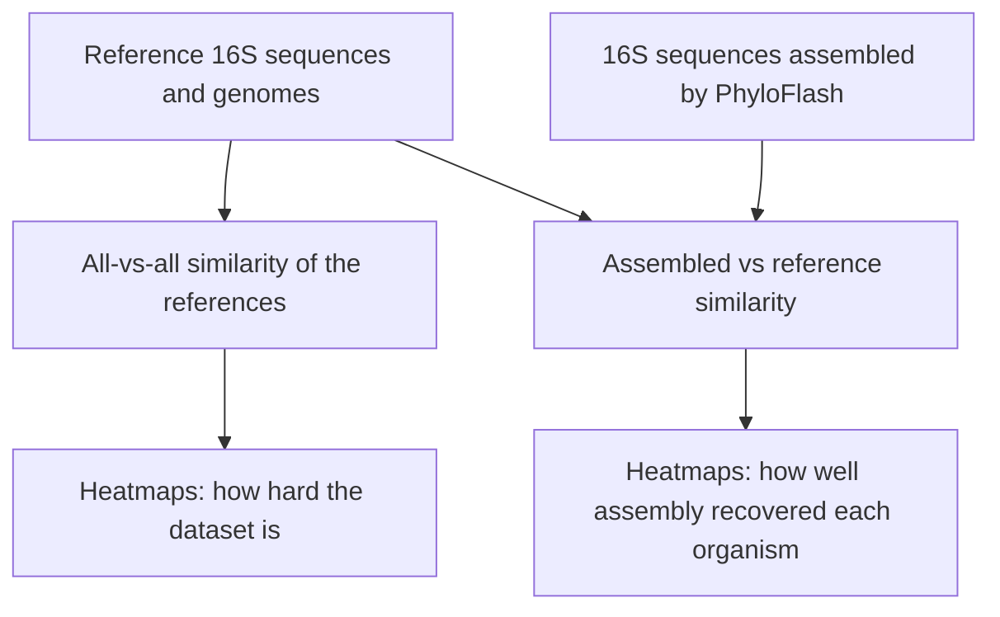
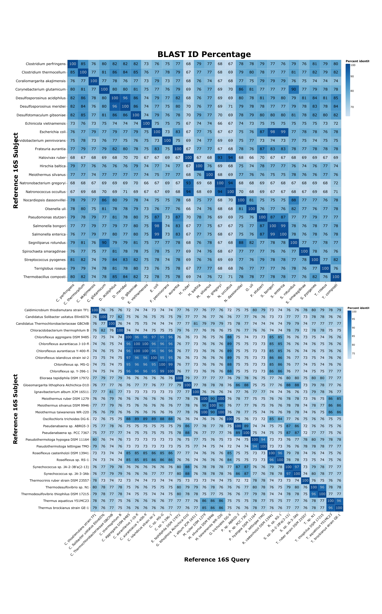
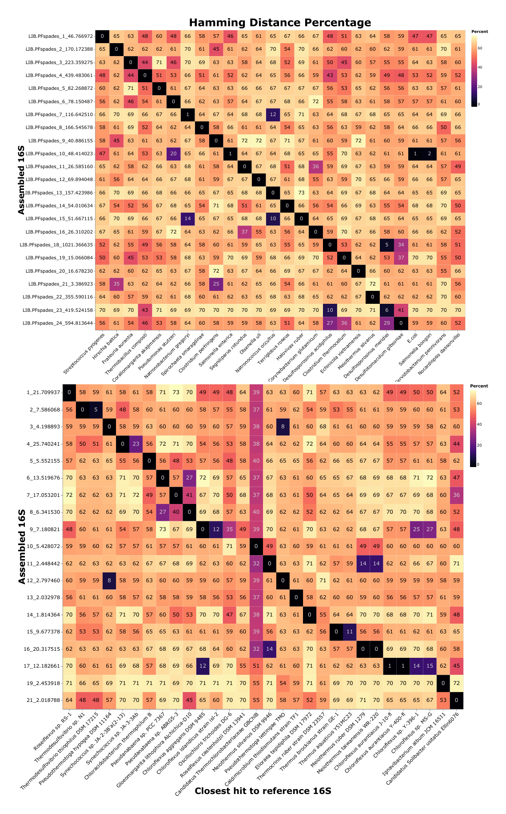

# Metagenomic Classification

R scripts I wrote in 2022 as a research assistant at San José State University, for a study comparing metagenome assembly tools with deep learning classifiers for identifying the organisms in a microbial sample. They measure how similar the organisms in each test dataset are to one another, and how closely the 16S sequences recovered by assembly match the true reference sequences.

**Paper:** Chau, S., Rojas, C., Jetcheva, J.G., Markart, M., Vijayakumar, S., Yuan, S., **Stowbunenko, V.**, Shelton, A.N., & Andreopoulos, W.B. (2025). Comparison between Ribosomal Assembly and Machine Learning Tools for Microbial Identification of Organisms with Different Characteristics. *Current Bioinformatics*, 20(7), 595 to 619. https://doi.org/10.2174/0115748936299440240709070105 (preprint: https://doi.org/10.1101/2022.09.30.510284)

My contribution: analysis code and manuscript graphics.

## The study in brief

The paper evaluates assembly and profiling tools (PhyloFlash, MEGAHIT, MetaSPAdes, Kraken2, Mothur, UniCycler and PathRacer) against two deep learning classifiers, DNABERT and DeLUCS, on two synthetic communities. It finds the two families of tools complementary: PhyloFlash and DeLUCS together identified more organisms than either alone, and organisms with highly repetitive genomes were the hardest for both.

## Published data

The data behind the paper is open access on Zenodo, and I am a named author: https://doi.org/10.5281/zenodo.7949233 (all versions), with releases at https://doi.org/10.5281/zenodo.7949234 and https://doi.org/10.5281/zenodo.7953871.

## What these scripts do

Three similarity measures, each computed all-against-all and plotted as a heatmap:

- **Hamming distance** between 16S sequences. Each reference file can hold several 16S copies, so the shorter sequence slides along the longer one and the minimum distance is kept.
- **BLAST percent identity** between 16S sequences, using rBLAST.
- **Average nucleotide identity (ANI)** between whole reference genomes, using FastANI.

Datasets:

- **MBARC-26**, a mock community of 26 organisms.
- **Hot Springs Mat**, a synthetic community of Yellowstone hot spring organisms provided by Amanda Shelton (labelled `amanda` in the file names), derived from samples described in Shelton et al. 2025, *ISME J*, https://doi.org/10.1093/ismejo/wraf001.
- **E. coli**, a set of E. coli 16S sequences compared with each other.

The heatmaps these scripts produce appear in the paper as Figures 1 to 4, each with MBARC-26 on top and Hot Springs Mat below. Two of them:

*Left: BLAST percent identity between all reference 16S sequences, showing how similar the organisms in each dataset are. Right: Hamming distance between the 16S sequences PhyloFlash assembled and the reference sequences, where 0 means an exact match. Figures 1 and 4 from the bioRxiv preprint of the paper (https://doi.org/10.1101/2022.09.30.510284), licensed under CC BY. I produced these heatmaps with the scripts in this repository.*

## Code

All scripts are in `scripts/`, named by what they do, the dataset and the date.

| Prefix | What it does |
|---|---|
| `calc.hd_*` | Computes Hamming distances and writes them to CSV |
| `plot.hd.heatmap_*` | Plots the Hamming distance heatmaps |
| `plot.blast.id.perc.heatmap_*` | Runs BLAST and plots percent-identity heatmaps |
| `plot.ani.heatmap_*` | Runs FastANI on whole genomes and plots ANI heatmaps |
| `get_amanda_whole_genome_names_*` | Lists the Hot Springs Mat reference genomes |

`real16s.vs.real16s` compares reference sequences with each other; `assembled16s.vs.real16s` compares assembled sequences with the references.

Main dependencies: R with data.table, seqinr, stringdist, Biostrings, rBLAST and ggplot2, plus BLAST+ and FastANI installed on the system.

The sequence data and results are not included. The scripts expect them under `data/` and write to `results/`.

## Author

Vincent Stowbunenko, [HappyHackingOrange](https://github.com/HappyHackingOrange)

## Acknowledgments

This work was supervised by Dr. William B. Andreopoulos (Department of Computer Science, San José State University). The Hot Springs Mat dataset was provided by Amanda N. Shelton (Carnegie Institution for Science).
